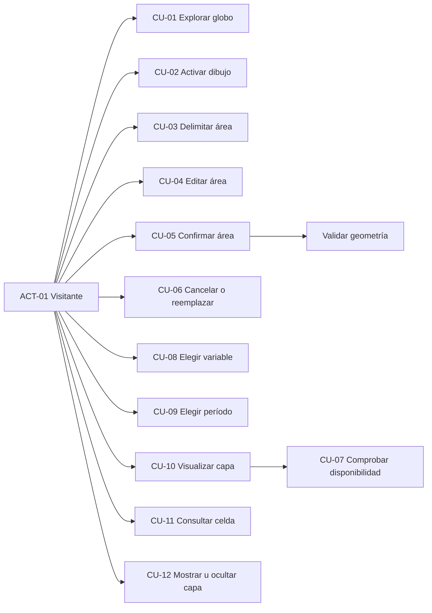
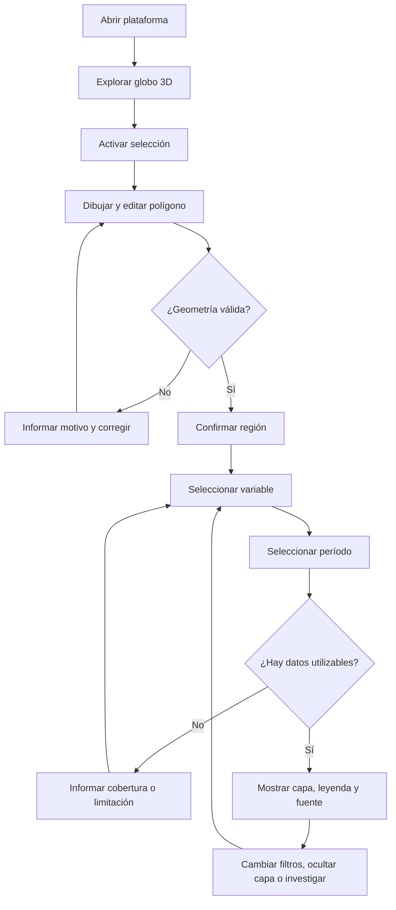

# EarthScope AI — Planetary Investigation Lab
## Documento 02. Casos de uso y flujos de interacción

**Equipo:** RoboKids  
**Versión:** 0.1 — Especificación funcional propuesta  
**Estado:** Para revisión del equipo  
**Documento base:** [01 — Visión y definición](01_VISION_Y_FUNCIONAMIENTO.md)

---

## 1. Propósito

Describir cómo interactuará el visitante con el Módulo 01, desde la exploración del planeta hasta la visualización de datos ambientales históricos. Se especifica el **comportamiento esperado**, sin describir componentes de programación ni estados de implementación.

## 2. Alcance

Este documento abarca exploración del globo, dibujo y edición de polígonos, validación y confirmación, selección de variables y períodos, consulta de disponibilidad, representación de capas y manejo de errores.

No incluye los casos de uso detallados de simulación, análisis avanzado de tendencias ni administración de cuentas.

## 3. Actores

| Código | Actor | Descripción |
|---|---|---|
| ACT-01 | Visitante | Persona que accede a la plataforma sin iniciar sesión y realiza una investigación ambiental. |

Las fuentes científicas son **sistemas o recursos externos de información**, no actores humanos.

## 4. Catálogo de casos de uso

| Código | Caso de uso | Prioridad |
|---|---|---|
| CU-01 | Explorar el globo terráqueo | Alta |
| CU-02 | Activar selección poligonal | Alta |
| CU-03 | Delimitar área geográfica | Alta |
| CU-04 | Editar área geográfica | Alta |
| CU-05 | Confirmar área geográfica | Alta |
| CU-06 | Cancelar o reemplazar selección | Alta |
| CU-07 | Consultar disponibilidad de datos ambientales | Alta |
| CU-08 | Seleccionar variable ambiental | Alta |
| CU-09 | Seleccionar período histórico | Alta |
| CU-10 | Visualizar capa ambiental | Alta |
| CU-11 | Consultar información de una celda | Media; evolución |
| CU-12 | Activar o desactivar capa ambiental | Alta |

## 5. Diagrama general de casos de uso

Este diagrama representa relaciones funcionales de forma simplificada; no pretende ser una notación UML estricta.

## 6. Especificación de casos de uso

### CU-01. Explorar el globo terráqueo

- **Actor:** ACT-01.
- **Precondición:** el visitante ha abierto la plataforma.
- **Flujo principal:** (1) se presenta el globo; (2) el visitante lo rota o modifica el nivel de acercamiento; (3) el sistema actualiza la vista.
- **Alternativa:** si no es posible cargar la representación, se muestra un mensaje y una opción de reintento.
- **Postcondición:** el visitante identifica visualmente una región de interés.

### CU-02. Activar selección poligonal

- **Actor:** ACT-01.
- **Precondición:** el globo está disponible.
- **Flujo principal:** (1) el visitante activa «Seleccionar área»; (2) el sistema informa que está en modo dibujo; (3) los clics sobre el globo pasan a crear vértices.
- **Alternativa:** el visitante cancela el modo dibujo sin crear una región.
- **Postcondición:** la plataforma queda lista para recibir vértices.

### CU-03. Delimitar área geográfica

- **Actor:** ACT-01.
- **Precondición:** modo de dibujo activo.
- **Flujo principal:** (1) el visitante marca un primer punto sobre el globo; (2) agrega sucesivos puntos; (3) el sistema muestra los vértices y segmentos; (4) el visitante solicita cerrar el polígono; (5) se presenta el contorno y el relleno del área.
- **Alternativa A1:** intenta cerrar con menos de tres vértices distintos; el sistema solicita agregar puntos.
- **Alternativa A2:** el visitante deshace el último vértice.
- **Postcondición:** existe un polígono provisional listo para validación o edición.

### CU-04. Editar área geográfica

- **Actor:** ACT-01.
- **Precondición:** existe una selección provisional.
- **Flujo principal:** (1) el visitante arrastra un vértice, inserta uno nuevo o elimina uno existente; (2) el contorno se actualiza; (3) el sistema vuelve a comprobar la geometría.
- **Alternativa A1:** una edición produce una intersección entre bordes; se informa que debe corregirse.
- **Alternativa A2:** la eliminación deja menos de tres vértices; la figura vuelve al estado incompleto.
- **Alternativa A3:** el visitante deshace la última modificación.
- **Postcondición:** la geometría provisional refleja la edición.

### CU-05. Confirmar área geográfica

- **Actor:** ACT-01.
- **Precondición:** el polígono está cerrado.
- **Flujo principal:** (1) el visitante solicita confirmar; (2) el sistema valida la geometría; (3) si es válida, la región se establece como área de estudio temporal; (4) se habilita su utilización en la consulta ambiental.
- **Alternativa A1:** geometría inválida; se impide la confirmación y se informa el motivo.
- **Alternativa A2:** geometría válida sin datos ambientales para una variable o período; la región puede confirmarse, pero la limitación se informa en la consulta.
- **Postcondición:** hay una región de estudio confirmada para la sesión.

### CU-06. Cancelar o reemplazar selección

- **Actor:** ACT-01.
- **Precondición:** existe un dibujo provisional o una región confirmada.
- **Flujo principal:** (1) el visitante solicita cancelar o iniciar otra selección; (2) el sistema descarta la geometría correspondiente; (3) vuelve al estado de selección.
- **Alternativa:** si reemplaza una región confirmada, se comunica que la nueva selección sustituirá a la anterior.
- **Postcondición:** no existe selección activa o se ha iniciado una nueva.

### CU-07. Consultar disponibilidad de datos ambientales

- **Actor:** ACT-01; el sistema realiza la comprobación.
- **Precondición:** existe una región confirmada, una variable y un período seleccionados.
- **Flujo principal:** (1) se determina la cobertura del producto para el área y período; (2) se comprueba la existencia de valores utilizables; (3) se informa si la cobertura es suficiente, parcial o inexistente.
- **Alternativa A1:** producto restringido a tierra y área sobre océano; se informa la limitación.
- **Alternativa A2:** período no cubierto; se ofrece un período compatible.
- **Alternativa A3:** error al obtener la información; se informa el fallo y se permite reintentar.
- **Postcondición:** el visitante conoce la disponibilidad real de datos para su consulta.

### CU-08. Seleccionar variable ambiental

- **Actor:** ACT-01.
- **Precondición:** el catálogo de variables está disponible.
- **Flujo principal:** (1) el visitante abre el catálogo; (2) elige una variable; (3) se muestra su nombre, unidad, descripción y fuente; (4) se actualizan las opciones de período compatibles.
- **Alternativa:** variable sin datos en el área; se informa sin borrar el polígono.
- **Postcondición:** existe una variable seleccionada.

### CU-09. Seleccionar período histórico

- **Actor:** ACT-01.
- **Precondición:** existe una variable seleccionada.
- **Flujo principal:** (1) se muestran los períodos compatibles con el producto; (2) el visitante elige un año o intervalo disponible; (3) se actualiza la consulta.
- **Alternativa:** no existen datos para el período; se informa y se ofrecen alternativas.
- **Postcondición:** existe un período de consulta válido o se presenta una limitación explícita.

### CU-10. Visualizar capa ambiental

- **Actor:** ACT-01.
- **Precondición:** hay variable, período y datos disponibles.
- **Flujo principal:** (1) el sistema obtiene la representación espacial correspondiente; (2) muestra la capa sobre el globo; (3) presenta leyenda, unidades, período, fuente y advertencias; (4) diferencia las celdas sin dato.
- **Alternativa A1:** cobertura parcial; se muestra únicamente información respaldada por datos y se comunica la cobertura.
- **Alternativa A2:** error de carga; se informa y se ofrece reintentar.
- **Postcondición:** el visitante interpreta una capa ambiental correctamente identificada.
- **Decisión pendiente:** precisar si la capa se recorta visualmente al polígono o si el polígono se resalta sobre una capa más amplia.

### CU-11. Consultar información de una celda

- **Actor:** ACT-01.
- **Prioridad:** evolución.
- **Precondición:** se visualiza una capa con valores consultables.
- **Flujo principal:** (1) el visitante selecciona una celda; (2) el sistema presenta valor, unidad, fecha, fuente y resolución.
- **Alternativa:** celda sin valor válido; se muestra «Sin datos».
- **Postcondición:** el visitante conoce el dato asociado a esa celda y sus límites de precisión.

### CU-12. Activar o desactivar capa ambiental

- **Actor:** ACT-01.
- **Precondición:** existe una capa seleccionada.
- **Flujo principal:** (1) el visitante oculta la capa; (2) el sistema deja visible el globo y conserva área, variable y período; (3) el visitante puede volver a mostrarla.
- **Postcondición:** la visibilidad cambia sin perder la investigación en curso.

## 7. Flujo general de interacción

## 8. Validaciones geométricas

| ID | Validación | Comportamiento |
|---|---|---|
| VG-01 | Al menos tres vértices distintos | No permite cerrar o confirmar si faltan |
| VG-02 | Coordenadas dentro de rangos geográficos | Rechaza coordenadas inválidas |
| VG-03 | Área positiva; vértices no colineales | Solicita corregir la figura |
| VG-04 | Sin autointersecciones | Identifica bordes cruzados |
| VG-05 | Contorno cerrado para confirmación | Solicita cerrar la figura |
| VG-06 | Interpretación coherente del cruce del antimeridiano | Evita interpretar incorrectamente la región |
| VG-07 | Tratamiento definido de regiones polares o excesivamente grandes | Aplica la política geométrica aprobada |

**Importante:** VG-07 requiere definir formalmente sus límites. No debe afirmarse que un polígono es inválido solo porque no existan datos científicos para él.

## 9. Reglas aplicables

Este documento adopta las reglas RN-01 a RN-15 del Documento 01. En particular:

- **RN-03 y RN-04:** determinan si el polígono puede confirmarse.
- **RN-07:** determina si una consulta ambiental puede devolver información utilizable; es una comprobación diferente.
- **RN-08 y RN-09:** permiten continuidad temporal sin crear historial permanente.
- **RN-10, RN-11 y RN-14:** protegen la interpretación de las visualizaciones.

## 10. Criterios de aceptación funcionales

1. El visitante puede explorar el globo sin cuenta.
2. Puede crear un polígono mediante clics directos sobre el globo.
3. Puede mover, insertar y eliminar vértices antes de confirmar.
4. Una geometría inválida no puede confirmarse y genera una explicación.
5. Una geometría válida puede confirmarse aunque una consulta posterior no tenga datos.
6. Puede seleccionar una variable y un período compatibles.
7. La capa muestra leyenda, unidad, período, fuente y tratamiento de datos ausentes.
8. Cambiar filtros u ocultar la capa no elimina la región confirmada.
9. Un error de consulta no se presenta como si fuera una medición ambiental.

## 11. Puntos pendientes de acuerdo

- Interacción exacta para cerrar el polígono y para insertar/eliminar vértices.
- Política para áreas diminutas, regiones polares y polígonos muy extensos.
- Recorte visual de capas frente a resaltado del área.
- Alcance de los períodos mensuales.
- Incorporación de consulta de valores por celda.

---

**Siguiente documento:** [03 — Modelo conceptual de información](03_MODELO_CONCEPTUAL.md).
