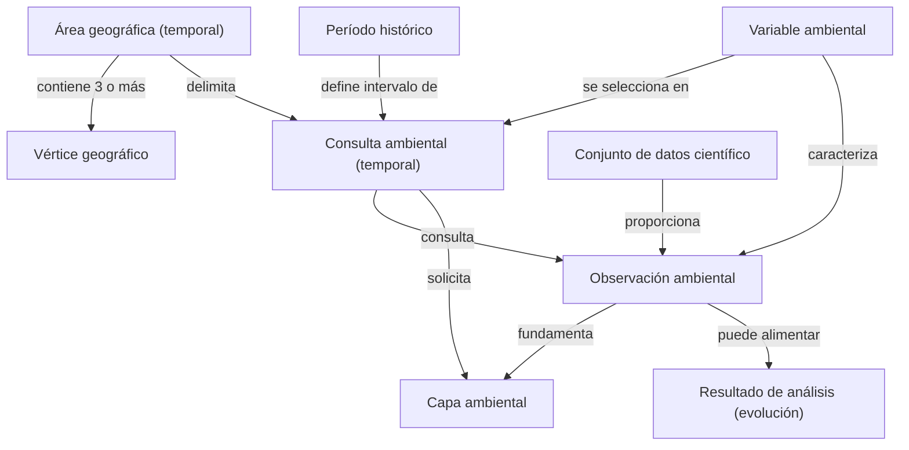

# EarthScope AI — Planetary Investigation Lab
## Documento 03. Modelo conceptual de información

**Equipo:** RoboKids  
**Versión:** 0.1 — Modelo conceptual propuesto  
**Estado:** Para revisión del equipo  
**Documentos base:** [01 — Visión](01_VISION_Y_FUNCIONAMIENTO.md) · [02 — Casos de uso](02_CASOS_DE_USO.md)

---

## 1. Propósito

Identificar los conceptos de información necesarios para la exploración geográfica y visualización ambiental histórica, sus atributos y relaciones. El modelo describe el **dominio del problema**, no una estructura de carpetas, un formato de archivo ni una base de datos ya elegida.

## 2. Criterios de modelado

1. Diferenciar la información temporal de la sesión del visitante de los catálogos y datos científicos.
2. No introducir una entidad «Usuario» porque la plataforma no requiere cuentas.
3. Representar explícitamente la geometría del área mediante vértices ordenados.
4. Distinguir **variable ambiental**, **fuente científica**, **observación** y **capa visual**.
5. Modelar la consulta ambiental como una combinación de área, variable y período.
6. Tratar los resultados de análisis científico avanzado como una extensión del dominio.

## 3. Conceptos y atributos

### 3.1. Área geográfica

Región elegida por el visitante mediante un polígono.

| Atributo | Descripción |
|---|---|
| Identificador temporal | Referencia durante la sesión |
| Nombre descriptivo | Etiqueta opcional de la región |
| Estado | En dibujo, provisional, válida, inválida o confirmada |
| Geometría | Contorno definido por vértices ordenados |
| Área estimada | Superficie calculada para fines informativos |
| Cruza antimeridiano | Indicador geométrico, si aplica |

**Naturaleza:** temporal. No implica almacenamiento permanente.

### 3.2. Vértice geográfico

Punto que forma parte del contorno de un área.

| Atributo | Descripción |
|---|---|
| Orden | Posición dentro del contorno |
| Latitud | Coordenada geográfica entre -90 y 90 grados |
| Longitud | Coordenada geográfica normalizada |
| Área asociada | Región a la que pertenece |

**Relación:** un área posee tres o más vértices distintos para constituir un polígono válido. El cierre geométrico no implica crear un vértice independiente adicional en el modelo conceptual.

### 3.3. Variable ambiental

Magnitud o índice científico que se desea estudiar.

| Atributo | Descripción |
|---|---|
| Código | Identificador del indicador |
| Nombre | Denominación comprensible |
| Definición | Qué representa |
| Unidad | Unidad de medición o índice |
| Tipo | Observada, derivada o procedente de reanálisis |
| Advertencias | Limitaciones de interpretación |

Ejemplos: precipitación, temperatura de superficie, temperatura del aire, humedad relativa y EVI.

### 3.4. Conjunto de datos científico

Producto que proporciona valores ambientales.

| Atributo | Descripción |
|---|---|
| Identificador | Referencia del producto |
| Nombre | Nombre del conjunto de datos |
| Organismo | Institución responsable |
| Versión | Versión o edición |
| DOI o referencia | Identificador verificable, cuando exista |
| Cobertura espacial | Área geográfica soportada |
| Cobertura temporal | Fechas disponibles |
| Resolución espacial | Tamaño aproximado de celdas o muestras |
| Resolución temporal | Frecuencia de los datos |
| Limitaciones | Restricciones científicas o de calidad |

Ejemplos de productos considerados: GPM IMERG, MODIS y MERRA-2. Debe evitarse asumir que todos miden el mismo fenómeno o tienen cobertura idéntica.

### 3.5. Período histórico

Intervalo de tiempo sobre el cual se consulta información.

| Atributo | Descripción |
|---|---|
| Fecha inicial | Inicio de la consulta |
| Fecha final | Fin de la consulta |
| Granularidad | Anual, mensual u otra compatible |
| Etiqueta | Texto legible del período |

### 3.6. Consulta ambiental

Solicitud temporal que vincula una región, una variable y un período.

| Atributo | Descripción |
|---|---|
| Identificador temporal | Referencia durante la interacción |
| Área | Región confirmada |
| Variable | Indicador seleccionado |
| Período | Intervalo seleccionado |
| Estado | Pendiente, con datos, parcial, sin datos o error |
| Cobertura informada | Resultado de la evaluación de disponibilidad |

### 3.7. Observación ambiental

Valor asociado a una localización o celda, una fecha y una variable, proveniente de un conjunto de datos.

| Atributo | Descripción |
|---|---|
| Localización o celda | Referencia espacial |
| Fecha o intervalo | Referencia temporal |
| Variable | Indicador medido o derivado |
| Valor | Dato numérico, si existe |
| Unidad | Unidad del valor |
| Indicador de calidad | Estado de validez o ausencia de dato |
| Fuente | Conjunto de datos de procedencia |

**Precisión conceptual:** una observación puede ser una medición satelital, un valor derivado o un resultado de reanálisis; no todos deben etiquetarse como medición directa.

### 3.8. Capa ambiental

Representación espacial de información ambiental para una consulta.

| Atributo | Descripción |
|---|---|
| Variable | Indicador representado |
| Período | Intervalo de referencia |
| Extensión | Cobertura espacial visualizada |
| Escala de colores | Correspondencia color-valor |
| Leyenda | Rangos y unidades |
| Máscara de datos | Distingue valores válidos y ausencia de información |
| Fuente | Procedencia científica |

### 3.9. Resultado de análisis — extensión futura

Resultado derivado de un procedimiento científico, distinto de la observación original.

| Atributo | Descripción |
|---|---|
| Tipo | Tendencia, anomalía, comparación o simulación |
| Método | Procedimiento científico utilizado |
| Parámetros | Configuración del análisis |
| Resultado | Estimación calculada |
| Incertidumbre | Intervalo o medida de incertidumbre, si aplica |
| Robustez | Resultado de validación o sensibilidad |
| Limitaciones | Alcance de la interpretación |
| Procedencia | Datos y versiones utilizados |

No se exige que esta entidad sea implementada en la primera etapa.

## 4. Diagrama conceptual

## 5. Relaciones y cardinalidades conceptuales

| Relación | Cardinalidad propuesta | Observación |
|---|---|---|
| Área — Vértice | 1 a 3..N | Los vértices pertenecen a un contorno ordenado |
| Área — Consulta | 1 a 0..N | Varias consultas pueden usar la misma área durante la sesión |
| Variable — Consulta | 1 a 0..N | Cada consulta selecciona una variable |
| Período — Consulta | 1 a 0..N | Cada consulta usa un intervalo |
| Conjunto de datos — Observación | 1 a 0..N | Cada observación debe identificar su fuente |
| Variable — Observación | 1 a 0..N | Cada observación representa un indicador |
| Consulta — Capa | 1 a 0..N | Puede no producir capas cuando faltan datos |
| Observación — Capa | N a N | Una capa representa múltiples valores y una observación puede contribuir a varias vistas |

Estas cardinalidades son **conceptuales**, no llaves foráneas ni tablas obligatorias.

## 6. Información temporal y científica

| Concepto | Clasificación | Motivo |
|---|---|---|
| Área y vértices del visitante | Temporal | No se conserva historial personal |
| Variable seleccionada y período elegido | Temporal | Son preferencias de la investigación en curso |
| Consulta ambiental | Temporal | Describe una solicitud actual |
| Catálogo de variables | Referencia científica | Define indicadores y sus significados |
| Conjuntos de datos | Referencia científica | Identifican fuentes y cobertura |
| Observaciones | Datos científicos | Se conservan o consultan según la arquitectura elegida |
| Capa ambiental | Resultado de presentación | Puede generarse o recuperarse sin ser entidad persistente |
| Resultado de análisis | Derivado | Depende de datos y métodos reproducibles |

## 7. ¿Se necesita una base de datos relacional?

**No se deduce esa necesidad del modelo conceptual.** La primera etapa no requiere cuentas ni almacenamiento permanente de selecciones. Los datos científicos pueden organizarse en formatos adecuados para información espacial y temporal, pero esa decisión corresponde a arquitectura.

Una base de datos podría justificarse más adelante si se introducen áreas guardadas, proyectos compartidos, historial de consultas, colaboración o nuevos requisitos de auditoría.

Por lo tanto, este documento **no propone tablas físicas ni un modelo entidad-relación de persistencia**. Si se necesita uno, se derivará de requisitos aprobados y de una decisión arquitectónica explícita.

## 8. Reglas de integridad conceptual

1. Un área confirmada debe ser geométricamente válida.
2. Los vértices conservan su orden.
3. Una consulta debe identificar una variable y un período.
4. La cobertura científica es independiente de la validez del área.
5. Una observación sin valor válido no debe visualizarse como cero.
6. Cada capa debe poder relacionarse con la variable, período y fuente.
7. Los resultados derivados deben diferenciarse de las observaciones.
8. Las selecciones del visitante no deben tratarse como registros permanentes.

## 9. Decisiones pendientes

- Definir la política exacta de cobertura parcial.
- Definir si la capa se recorta al polígono o solo se destaca el contorno.
- Precisar el modelo de representación de celdas y la política para áreas menores que la resolución del producto.
- Determinar los tipos de resultados científicos que se incorporarán en módulos posteriores.

---

**Siguiente documento:** [04 — Requerimientos](04_REQUERIMIENTOS.md).
