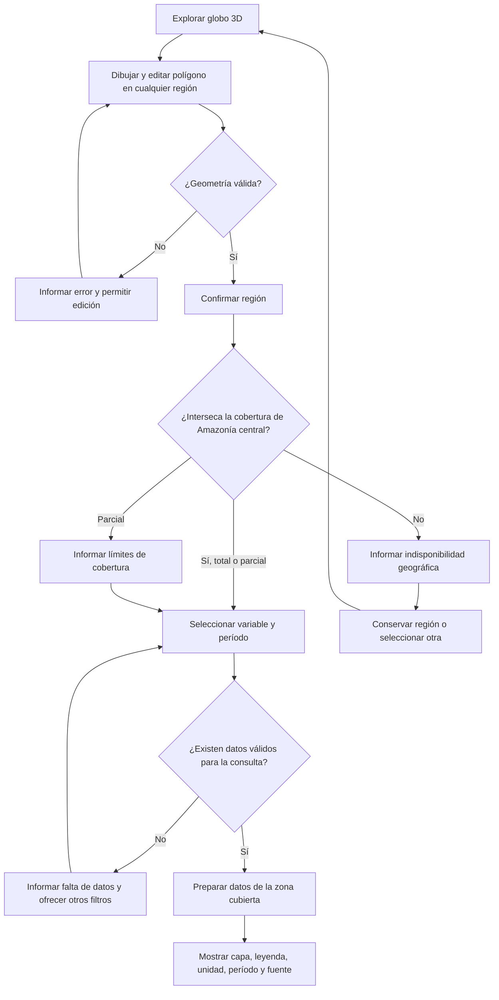

# EarthScope AI — Alcance geográfico y disponibilidad de datos del MVP

**Proyecto:** EarthScope AI — Planetary Investigation Lab  
**Equipo:** RoboKids  
**Versión:** 1.0 — Decisión de alcance del MVP  
**Estado:** Definición funcional para integrar a la documentación  
**Fecha:** 14 de noviembre de 2026  
**Documentos relacionados:** [01 — Visión y funcionamiento](01_VISION_Y_FUNCIONAMIENTO.md) · [02 — Casos de uso](02_CASOS_DE_USO.md) · [03 — Modelo conceptual](03_MODELO_CONCEPTUAL.md) · [04 — Requerimientos](04_REQUERIMIENTOS.md)

---

## 1. Propósito

Establecer el alcance geográfico del producto mínimo viable (MVP) de EarthScope AI, diferenciando la **libertad de exploración y selección de regiones en el planeta** de la **cobertura espacial disponible para consultar datos ambientales históricos**.

Esta definición orientará el comportamiento de la interfaz, las consultas ambientales y las pruebas de aceptación, sin imponer una tecnología de implementación.

## 2. Decisión de alcance

EarthScope AI permitirá que cualquier visitante explore el globo terráqueo tridimensional y dibuje, edite y confirme polígonos geográficos en **cualquier parte del mundo**.

Sin embargo, **durante este MVP solo se ofrecerán consultas y visualizaciones de datos ambientales históricos correspondientes a la región de estudio de la Amazonía central**. Las selecciones fuera de esa cobertura seguirán siendo geográficamente válidas cuando cumplan las reglas geométricas, pero el sistema informará que actualmente no dispone de datos para ofrecer la consulta.

La cobertura regional de referencia del MVP es la definida para la Amazonía central en la documentación científica del proyecto: aproximadamente **10° S a 2° N de latitud y 70° O a 50° O de longitud**. Este rectángulo es un **área de estudio técnica**: no representa toda la Amazonía ni garantiza valores válidos para cada variable, celda o período incluido en él.

**Principio rector:** *poder seleccionar una región no implica que existan datos ambientales para analizarla*.

## 3. Comportamiento esperado

### 3.1. Exploración mundial

El visitante podrá:

1. Navegar por cualquier región del planeta mediante el globo tridimensional.
2. Activar la herramienta de selección poligonal.
3. Agregar, mover y eliminar vértices directamente sobre el globo.
4. Cerrar y confirmar un polígono geométricamente válido, independientemente de su ubicación.
5. Conservar temporalmente la región confirmada durante la sesión de uso.

No se restringirá el dibujo o la confirmación del polígono a los límites de la Amazonía central.

### 3.2. Consulta de datos ambientales

Una vez confirmada la región, el sistema evaluará su intersección con el área de estudio del MVP y, al realizar la consulta, verificará además la disponibilidad real de la variable y del período seleccionados.

| Situación | Respuesta del sistema |
|---|---|
| **Cobertura espacial dentro de la Amazonía central** | Permitir elegir una variable y período disponibles; mostrar resultados solamente donde existan datos válidos. |
| **Selección totalmente fuera de la cobertura regional** | Permitir mantener la región confirmada; informar que todavía no hay datos ambientales del MVP para esa ubicación. |
| **Selección parcialmente superpuesta con la cobertura regional** | Informar que la cobertura es parcial y limitar el resultado a la parte comprendida dentro del área de estudio, siempre que existan valores válidos. |
| **Selección dentro de la región, pero sin datos de la variable o del período** | Informar la falta de datos específicos y permitir cambiar la variable o el período sin perder la selección. |
| **Error técnico durante la consulta** | Informar que la consulta falló, conservar la región y los filtros y ofrecer reintento; no presentar el fallo como ausencia comprobada de datos. |

### 3.3. Tratamiento de cobertura parcial

Cuando el polígono interseque parcialmente el área de estudio:

- La **selección geográfica completa** permanecerá visible y confirmada.
- Se distinguirá visualmente la **zona con cobertura** de la zona sin cobertura, en la medida en que la interfaz lo permita.
- La información ambiental mostrada corresponderá **exclusivamente a la intersección con datos utilizables**.
- El sistema advertirá que los resultados **no describen la totalidad del polígono seleccionado**.
- No se extrapolarán ni inventarán valores para zonas fuera de la cobertura.

El porcentaje de cobertura, si se muestra, deberá definirse mediante un método explícito y consistente (por ejemplo, cobertura espacial válida respecto de la superficie consultada). No se asumirán porcentajes sin calcularlos.

## 4. Reglas de negocio específicas del MVP

| Código | Regla |
|---|---|
| RN-MVP-01 | La exploración y la delimitación de polígonos estarán disponibles para cualquier región del planeta. |
| RN-MVP-02 | La cobertura de datos ambientales históricos del MVP se limitará a la región de estudio de la Amazonía central. |
| RN-MVP-03 | Un polígono fuera de la cobertura científica podrá confirmarse si es geométricamente válido. |
| RN-MVP-04 | La validez geométrica y la disponibilidad de datos deberán evaluarse por separado. |
| RN-MVP-05 | Si la región seleccionada está totalmente fuera de cobertura, el sistema comunicará la indisponibilidad actual de datos. |
| RN-MVP-06 | Si existe cobertura parcial, solamente se utilizarán datos válidos correspondientes a la zona cubierta y se informará la limitación. |
| RN-MVP-07 | La existencia de cobertura regional no garantizará datos para todas las variables ni todos los períodos. |
| RN-MVP-08 | Las zonas sin observaciones válidas no se mostrarán como si contuvieran mediciones. |
| RN-MVP-09 | Una consulta sin datos no borrará el polígono confirmado ni impedirá seleccionar otra región, variable o período. |
| RN-MVP-10 | La ampliación de cobertura geográfica se considerará para versiones posteriores, sin modificar el principio de selección mundial. |

**Nota de numeración:** los identificadores `RN-MVP-*` complementan las reglas `RN-*` existentes de los Documentos 01–04; no las sustituyen.

## 5. Mensajes de interfaz sugeridos

Los siguientes textos en inglés son propuestas para la experiencia del visitante:

| Estado | Mensaje sugerido |
|---|---|
| Datos disponibles | **Environmental data is available for this area. Select a variable and time period to explore.** |
| Fuera de cobertura | **Environmental data is not yet available for this region. This MVP currently supports historical data for the Central Amazon study region only. You can still select any area on Earth.** |
| Cobertura parcial | **Partial data coverage. Results will represent only the portion of your selected area covered by the Central Amazon dataset.** |
| Sin datos para la variable o período | **No valid data is available for the selected variable and time period in this area. Try another option.** |
| Error técnico | **We couldn't complete this data request. Your selected area has been preserved. Please try again.** |

Estos mensajes deberán adaptarse a los detalles reales de cada consulta, evitando afirmar disponibilidad cuando todavía no se haya comprobado.

## 6. Flujo funcional del MVP

## 7. Criterios de aceptación

| ID | Escenario | Resultado esperado |
|---|---|---|
| CA-MVP-01 | El visitante dibuja y confirma un polígono válido fuera de la Amazonía central. | La región se confirma y se informa que no existen datos ambientales del MVP para esa ubicación. |
| CA-MVP-02 | El visitante dibuja una región válida dentro de la Amazonía central. | Puede seleccionar variable y período y consultar los datos disponibles. |
| CA-MVP-03 | El visitante dibuja un polígono que cruza el límite de la zona de estudio. | Se informa cobertura parcial y los resultados se restringen a la intersección con datos válidos. |
| CA-MVP-04 | El visitante consulta una variable o un período sin datos en un área cubierta. | Se informa la limitación sin eliminar el polígono. |
| CA-MVP-05 | El visitante intenta confirmar un polígono geométricamente inválido, incluso dentro de la Amazonía. | Se rechaza la confirmación y se explica cómo corregirlo. |
| CA-MVP-06 | La obtención de datos falla por una causa técnica. | Se distingue el error de la falta de cobertura y se permite reintentar. |
| CA-MVP-07 | El visitante cambia la variable o el período. | Se conserva la región y se actualiza la disponibilidad y la representación de la capa. |
| CA-MVP-08 | El visitante visualiza datos históricos. | La capa presenta unidad, período, fuente y señalización de datos ausentes. |

## 8. Impacto sobre los documentos del proyecto

| Documento | Sección que debe reflejar esta decisión |
|---|---|
| **01 — Visión y funcionamiento** | Alcance geográfico del MVP, restricciones y reglas de negocio. |
| **02 — Casos de uso** | CU-05 (confirmación), CU-07 (disponibilidad) y CU-10 (visualización); flujos alternativos sin datos y cobertura parcial. |
| **03 — Modelo conceptual** | Cobertura espacial del conjunto de datos, consulta ambiental y diferencia entre geometría válida y datos disponibles. |
| **04 — Requerimientos** | Selección mundial, disponibilidad limitada a Amazonía central, manejo de cobertura parcial, ausencia de datos y errores. |

Este documento define una **restricción de alcance del MVP**, no una restricción permanente de la visión global de EarthScope AI. Los documentos 01–04 deberán mantenerse coherentes con ella.

## 9. Consideraciones y límites

- La región de estudio de la Amazonía central se define por los límites geográficos indicados en la documentación científica del proyecto; la cobertura real depende del producto y sus celdas válidas.
- Un polígono parcial o más pequeño que una celda requiere una política espacial explícita; no se debe atribuir precisión geográfica superior a la resolución del producto.
- Este documento no define tecnologías, rutas de código, sistemas de almacenamiento ni despliegue.
- No se asume que existan datos disponibles mundialmente en este MVP, aunque la plataforma permita navegar y seleccionar cualquier lugar del planeta.

---

**Decisión resumida:** **selección geográfica mundial; consulta ambiental histórica limitada a Amazonía central durante el MVP.**
