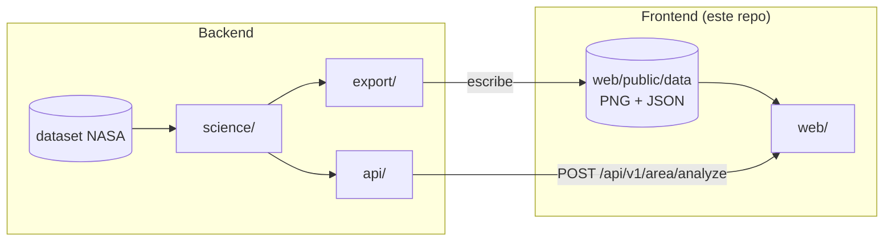

# EarthScope AI — Planetary Investigation Lab · Frontend y documentación

**Equipo RoboKids · NASA Space Apps Challenge 2026 · "Be an Earth System Trend Detective"**

> *Don't just observe Earth's changes. Investigate them, simulate possibilities, and uncover the evidence.*

Un globo 3D donde cualquier persona elige un lugar o dibuja un área del planeta y obtiene, con datos satelitales de NASA de 2001 a 2024:
- mapas animados;
- la tendencia de lluvia, vegetación, temperatura y humedad;
- su significancia estadística y una prueba de robustez;
- las advertencias de cada fuente.

## Dos repositorios

| Repo | Qué tiene |
|---|---|
| **Este (Frontend)** — [junher30/RK_Vanguard_EarthScopeAI](https://github.com/junher30/RK_Vanguard_EarthScopeAI) | `web/` (Next.js) y `docs/` (toda la documentación del proyecto y la gestión de historias de usuario) |
| **Backend** — [jose6668/RK_Vanguard_EarthScopeAI-BACK](https://github.com/jose6668/RK_Vanguard_EarthScopeAI-BACK) | Ciencia (`science/`), API (`api/`), pipeline NASA, exportadores y el **dataset global completo** (369 MB, viene al clonar) |



## Inicio rápido

Clona los dos repos uno al lado del otro:
```bash
git clone https://github.com/junher30/RK_Vanguard_EarthScopeAI.git
git clone https://github.com/jose6668/RK_Vanguard_EarthScopeAI-BACK.git
```

```bash
# Backend (API de análisis de áreas) → http://localhost:8000/docs
cd RK_Vanguard_EarthScopeAI-BACK
python3 -m venv .venv && source .venv/bin/activate
pip install -r requirements-backend.txt
uvicorn api.main:app --reload --port 8000
```

```bash
# Frontend → http://localhost:3000
cd RK_Vanguard_EarthScopeAI
npm --prefix web install
npm --prefix web run dev
```

- Las capas del globo (`web/public/data/`) ya están en este repo, así que la web funciona aunque la API esté apagada. Lo único que necesita la API es el análisis de "Your area".
- La URL de la API se configura con `NEXT_PUBLIC_API_URL` (por defecto `http://localhost:8000`).
- Para regenerar las capas, desde el Backend: `python export/build_global_data.py` y `python export/build_site_data.py`. Escriben solas en `../RK_Vanguard_EarthScopeAI/web/public/data/`.

## Estructura de este repo

| Carpeta | Qué hay |
|---|---|
| [`web/`](web/) | App Next.js 16: globo (react-globe.gl), capas, polígono, panel de análisis. Antes de tocarla, lee `web/AGENTS.md` |
| [`docs/`](docs/) | Documentos 01–06, referencia, diagramas, **gestión de HU** y plan de trabajo |
| `.github/` | CI de la web, plantillas de PR y de issues (incluye "Historia de usuario") |

**¿Por dónde empiezo?**
0. 👉 **[docs/GUIA_PARA_EL_EQUIPO.md](docs/GUIA_PARA_EL_EQUIPO.md)**: paso a paso desde cero hasta tu primer PR.
1. [docs/README.md](docs/README.md): el mapa de documentos.
2. [CONTRIBUTING.md](CONTRIBUTING.md): cómo trabajar.
3. [docs/gestion/RUBRICA_HISTORIAS_DE_USUARIO.md](docs/gestion/RUBRICA_HISTORIAS_DE_USUARIO.md) y el [backlog de HU](docs/gestion/BACKLOG_HU.md): qué hacer y cómo.

## Fuentes NASA
GPM IMERG V07 · MODIS MOD13C2 y MOD11C3 v6.1 · MERRA-2 M2TMNXSLV (reanálisis). DOI y detalles en el [README del Backend](https://github.com/jose6668/RK_Vanguard_EarthScopeAI-BACK#fuentes-nasa). Imágenes del globo: NASA Blue Marble / Black Marble. Fronteras: Natural Earth.

## Uso de IA
Se usó un asistente de IA (Claude, de Anthropic) para asesoría técnica, código y documentación. Detalle en [docs/referencia/DOCUMENTACION_TECNICA.md §17](docs/referencia/DOCUMENTACION_TECNICA.md).
