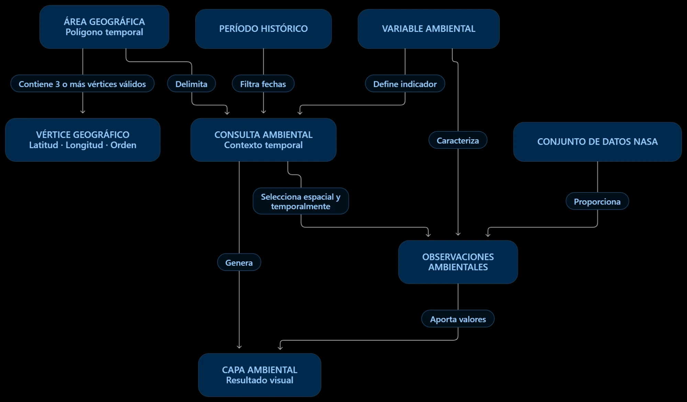
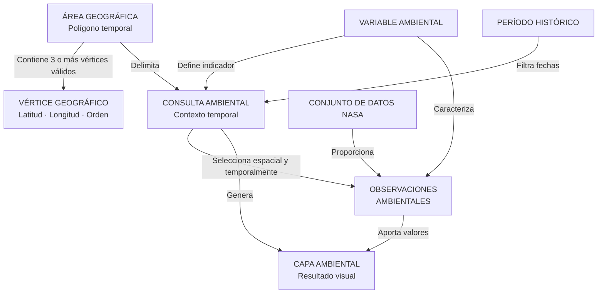
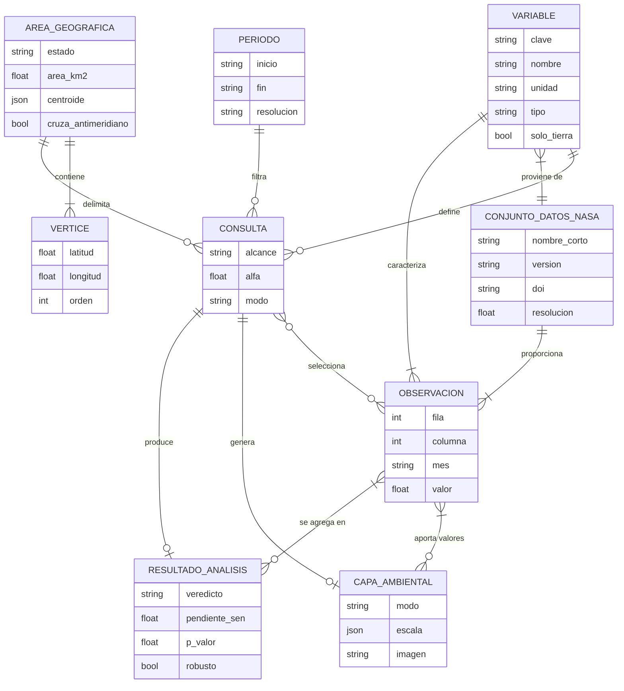

# EarthScope AI
## Documento 03 — Modelo conceptual de información

**Proyecto:** EarthScope AI — Planetary Investigation Lab · Equipo RoboKids · NASA Space Apps Challenge 2026
**Módulo:** 1 — Exploración Global y Visualización Ambiental Histórica
**Versión:** 0.1 (diagrama del equipo + correspondencia con lo construido)
**Fecha:** 14 de noviembre de 2026
**Documentos de referencia:** [Documento 01](01_VISION_Y_FUNCIONAMIENTO.md) · [Documento 02, §10](02_CASOS_DE_USO.md)

Leyenda: 🕒 **temporal** (vive solo durante la sesión del visitante) · 💾 **persistente** (archivo del proyecto) · ⚙️ **derivado** (se calcula a partir de otras entidades)

---

## 1. Propósito

Representar la información que maneja el Módulo 1 (áreas, vértices, variables, fuentes científicas, períodos, observaciones y capas ambientales) y separar claramente la **información temporal del visitante** de los **datos científicos persistentes**.

Este es un modelo **conceptual**: no implica una base de datos relacional. En EarthScope AI los datos persistentes son **archivos** (NetCDF/HDF de NASA procesados a `.npz`, JSON y PNG). La información del visitante vive en el estado de la página y en `sessionStorage` (§6).

## 2. Diagrama del equipo

Versión editable (GitHub la dibuja automáticamente):

## 3. Entidades

### 3.1. Área geográfica 🕒
Región delimitada por el visitante. También puede ser un **punto** (una celda) o una **región de estudio predefinida** (la caja de la Amazonía, 💾).

| Atributo | Tipo | Ejemplo | En el código |
|---|---|---|---|
| id temporal | texto | `confirmedAt` | `area.properties.confirmedAt` |
| vértices | lista ordenada de Vértice (≥ 3) | — | `area.geometry.coordinates[0]` |
| estado | en edición · cerrada · confirmada | `confirmed` | `draw.status` / `area.properties.status` |
| área | km² | 1 248 632 | `areaKm2` |
| centroide | lat, lng | −1,48; −56,00 | `centroid` |
| cruza el antimeridiano | sí/no | no | `crossesAntimeridian` |
| cobertura de datos | fracción + celdas | 0,91 · 9 188 | `dataCoverage` |

Formato: GeoJSON `Feature<Polygon>` (RFC 7946) en `web/lib/store.ts`. Validación V-01…V-07 en `web/lib/geo.ts`.

### 3.2. Vértice geográfico 🕒
| Atributo | Tipo | Regla |
|---|---|---|
| latitud | grados, −90…90 | V-02 |
| longitud | grados, −180…180 (se desenvuelve si cruza ±180°) | V-02 |
| orden | posición en el anillo | El orden define los lados; no puede haber lados que se crucen (V-04) |

En GeoJSON el par es **`[lon, lat]`** y el anillo se cierra repitiendo el primer vértice.

### 3.3. Período histórico 🕒
| Atributo | Tipo | Valores actuales |
|---|---|---|
| inicio, fin | AAAA-MM | 2001-01 … 2024-12 |
| resolución | mensual · anual | Mensual en los datos y en el análisis; **anual** en las capas del globo |
| año seleccionado | AAAA | `useLayer.year` |

Lo condiciona la cobertura de cada conjunto de datos (RN-13).

### 3.4. Variable ambiental 💾 (catálogo)
| Atributo | Ejemplo | En el código |
|---|---|---|
| clave | `rh2m_pct` | `science/variables.py` → `GLOBAL_VARIABLES` |
| nombre y definición | Relative humidity (2 m) | `label` |
| unidad | % | `units` |
| tipo | satélite · **reanálisis** | `kind` |
| solo tierra | sí/no | `land_only` |
| advertencias | "no es temperatura del aire" | `caveats` |
| conjunto de datos de origen | MERRA-2 | `dataset`, `doi` |

Variables actuales: precipitación, EVI (y NDVI), temperatura de superficie (día y noche), temperatura del aire, humedad relativa y humedad específica.

### 3.5. Conjunto de datos NASA 💾
| Atributo | Ejemplo |
|---|---|
| nombre corto y versión | `GPM_3IMERGM` v07 |
| DOI | 10.5067/GPM/IMERG/3B-MONTH/07 |
| archivo / proveedor | GES DISC · LP DAAC |
| resolución original | 0,1° · 0,05° · 0,5°×0,625° |
| cobertura temporal | 2001-01 → 2024-12 |

En el código: `PRODUCTS` en `pipeline/fetch_nasa.py` (regional) y `pipeline/fetch_global.py` (global).

### 3.6. Consulta ambiental 🕒
El "contexto" de lo que el visitante pide ver.

| Atributo | En el código |
|---|---|
| área (polígono, punto o región predefinida) | `AreaRequest.geometry` / `point` (API) |
| variable | `AreaRequest.variable` · `useLayer.variable` |
| período | `useLayer.year`, período de la serie |
| alcance | `global` (0,5°) · `amazon` (0,1°) — `useLayer.scope` |
| nivel de significancia α | `AreaRequest.alpha` (0,05) |
| modo de mapa | valor · anomalía · tendencia — `useLayer.mode` |

### 3.7. Observación ambiental 💾
Un valor científico en una celda, un mes y una variable.

| Atributo | Ejemplo |
|---|---|
| celda | fila, columna → lat, lon del centro (grilla 0,5° global o 0,1° Amazonía) |
| mes | 2023-10 |
| variable | `precip_mm_day` |
| valor | 3,12 (o vacío si no hay dato válido: RN-17) |
| procedencia | archivo NASA original (`source_file`) |

En el código: `data/global/<producto>/<AAAA-MM>.npz` (360 × 720) y `data/grids/amazon_core/<producto>/<AAAA-MM>.npz` (120 × 200).

### 3.8. Capa ambiental ⚙️ (💾 como archivo)
| Atributo | Ejemplo |
|---|---|
| variable, período, modo | EVI · 2024 · valor medio anual |
| escala de colores | mínimo, máximo y colores (`manifest.json → scale`) |
| unidad | index |
| imagen | `web/public/data/global/maps/evi/value/2024.png` |
| celdas sin dato | transparentes |

### 3.9. Resultado de análisis ⚙️ — *propuesta, no está en el diagrama*
Lo que el panel izquierdo muestra para el área: serie mensual y anual, anomalías, **tendencia** (veredicto, pendiente de Sen, p de Mann-Kendall, IC 95 %), **prueba de robustez** y advertencias.
En el código: respuesta de `POST /api/v1/area/analyze` (`science/area.py` → `science/trends.py`) y `web/public/data/**/series/<var>.json`.

## 4. Relaciones

| Relación (etiqueta del diagrama) | Cardinalidad | Regla |
|---|---|---|
| Área **contiene** Vértices | 1 — 3..N | RN-04 |
| Área **delimita** Consulta | 1 — 0..N | Una consulta usa una sola área |
| Período **filtra fechas** de la Consulta | 1 — 0..N | RN-13 |
| Variable **define el indicador** de la Consulta | 1 — 0..N | |
| Variable **caracteriza** Observaciones | 1 — N | |
| Conjunto de datos **proporciona** Observaciones | 1 — N | RN-12 |
| Consulta **selecciona** Observaciones (espacio y tiempo) | N — M | Celdas cuyo centro cae dentro del área × meses del período |
| Consulta **genera** Capa | 1 — 0..1 | |
| Observaciones **aportan valores** a la Capa | N — 1 | RN-15 |

### 4.1. Ajustes propuestos al diagrama
1. **Variable → proviene de → Conjunto de datos** (1 — 1). Hoy el diagrama no une estas dos entidades, pero cada variable sale de un único producto: la humedad de MERRA-2, la lluvia de IMERG. Esto hace explícita RN-12.
2. **Consulta → produce → Resultado de análisis** y **Observaciones → se agregan en → Resultado**. Es la segunda salida del sistema (serie y tendencia), no solo la capa visual.
3. **Área geográfica** puede ser un *polígono*, un *punto* o una *región predefinida*. Las capas globales se ven sin dibujar nada; en ese caso la "área" es el planeta entero.

## 5. Temporal frente a persistente

| Entidad | Naturaleza | Dónde vive | Cuánto dura |
|---|---|---|---|
| Área geográfica, Vértice | 🕒 | Estado de la página + `sessionStorage` (`earthscope.studyZone`) | Hasta cerrar la pestaña (RN-08, RN-09) |
| Consulta, Período seleccionado | 🕒 | Estado de la página (`useLayer`) | La sesión |
| Variable, Conjunto de datos | 💾 catálogo | `science/variables.py`, `pipeline/*.py`, `manifest.json` | Versionado en git |
| Observación | 💾 | `data/global/` (≈ 1,3 GB, fuera de git) y `data/grids/` (en git) | Se regenera con el pipeline |
| Capa ambiental | ⚙️ 💾 | `web/public/data/**/maps/*.png` | Se regenera con `export/` |
| Resultado de análisis | ⚙️ | API (caché en memoria) o `series/*.json` | Se recalcula bajo demanda |

## 6. ¿Hace falta una base de datos?

**No en el Módulo 1.** Las observaciones son grillas regulares (tiempo × latitud × longitud), y los archivos `.npz` mapeados en memoria las leen más rápido que una base relacional. Las áreas del visitante no se guardan de forma permanente (RN-09).

Habría que revisarlo si en el futuro se guardan áreas por usuario, se comparten resultados o se registran consultas.

## 7. Siguiente paso

El [Documento 04 — Requerimientos](04_REQUERIMIENTOS.md) parte de estas entidades para escribir los requerimientos funcionales y no funcionales.
