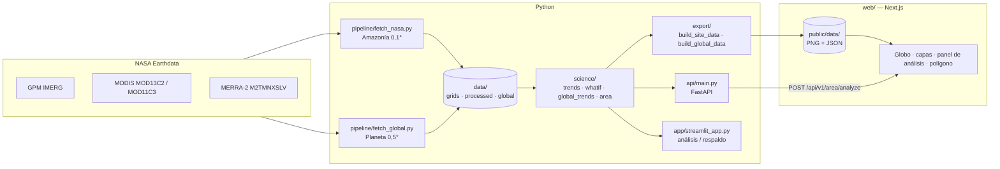
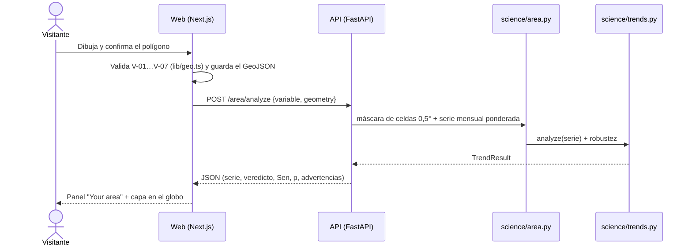

# EarthScope AI
## Diseño de arquitectura

**Versión:** 1.0 (describe lo que está construido) · **Fecha:** 14 de noviembre de 2026

## 1. Principio rector

**La interfaz nunca calcula ciencia.** Python (`science/`) es la única fuente de verdad. La web solo muestra resultados que vienen de archivos exportados o de la API.

## 2. Vista general



## 3. Componentes

| Capa | Carpeta | Tecnología | Responsabilidad |
|---|---|---|---|
| Ingesta | `pipeline/` | Python, earthaccess, h5py, pyhdf | Descargar mes a mes, control de calidad, re-grillar y borrar el archivo crudo; se puede reanudar |
| Datos | `data/` | `.npz`, CSV | Grillas mensuales (Amazonía 0,1° en git; global 0,5° fuera de git) |
| Ciencia | `science/` | NumPy, pandas, SciPy | Tendencias (Mann-Kendall estacional, Sen, OLS AR(1)), What-If, tendencias por celda, análisis de área |
| Exportación | `export/` | Python, Pillow | Generar PNG coloreados y JSON (series, tendencia, manifiesto) para la web |
| API | `api/` | FastAPI, Uvicorn | Análisis de cualquier polígono o punto bajo demanda |
| Web | `web/` | Next.js 16, React 19, TypeScript, Tailwind 4, react-globe.gl (three.js), Recharts, Motion, Zustand | Experiencia interactiva |
| App de análisis | `app/` | Streamlit, Plotly | Los 5 pasos del reto; respaldo |
| Pruebas | `tests/` | Python | Validación con datos sintéticos de respuesta conocida |

## 4. Web (`web/`)

```
web/
├── app/                    layout.tsx, page.tsx, globals.css (paleta y estilos)
├── components/
│   ├── explorer/           Explorer (pantalla), AreaPanel (polígono), StepRail (5 pasos)
│   ├── globe/              EarthGlobe (globo, capas, dibujo y arrastre de vértices)
│   └── data/               DataDock (capas, alcance, línea de tiempo), InsightPanel (análisis)
├── lib/
│   ├── store.ts            Estado del visitante: punto, polígono, área confirmada (sessionStorage)
│   ├── data.ts             Lectura de public/data/ y estado de capas (alcance, variable, modo, año)
│   ├── api.ts              Cliente de la API de análisis
│   ├── geo.ts              Geometría: validación, área esférica, antimeridiano, GeoJSON
│   └── regions.ts          Regiones predefinidas (espejo de science/variables.py)
└── public/
    ├── data/               Amazonía 0,1° (manifest, series, maps)
    ├── data/global/        Planeta 0,5° (manifest, series, maps + trend.png)
    ├── textures/ · geo/    Blue/Black Marble y fronteras (servidos localmente)
    └── legacy/explorer/    Primera versión en HTML (referencia)
```

**Estado:** Zustand. `useExplorer` maneja el área del visitante y `useLayer` la capa visible. La zona confirmada se guarda en `sessionStorage`; nunca en `localStorage` (RN-09).

**Next.js 16** trae cambios grandes respecto de versiones anteriores. Antes de tocar `web/`, lean `web/AGENTS.md` y la guía en `web/node_modules/next/dist/docs/`.

## 5. API (`api/main.py`)

| Método | Ruta | Cuerpo / parámetros | Respuesta |
|---|---|---|---|
| GET | `/api/v1/health` | — | Meses disponibles por variable |
| GET | `/api/v1/variables` | — | Catálogo `GLOBAL_VARIABLES` |
| POST | `/api/v1/area/analyze` | `{variable, geometry?: GeoJSON Polygon, point?: {lat,lng}, alpha?}` | Serie, tendencia, robustez y advertencias, o `{ok:false, reason}` |

Documentación interactiva en `http://localhost:8000/docs`. CORS abierto (datos públicos, sin credenciales).

## 6. Flujo de datos de una consulta de área



## 7. Despliegue (pendiente)

| Pieza | Destino | Nota |
|---|---|---|
| Web | Vercel | `web/` como raíz del proyecto. Variable `NEXT_PUBLIC_API_URL` = URL pública de la API |
| API | Render o Hugging Face Spaces | Necesita los cubos globales (`data/global/cubes/*.npy`, ≈ 1,5 GB) o una versión reducida (float16, ≈ 750 MB) |
| Respaldo | Streamlit Community Cloud | `app/streamlit_app.py` |

## 8. Decisiones

Ver el registro D1–D12 en [referencia/DOCUMENTACION_TECNICA.md §13](referencia/DOCUMENTACION_TECNICA.md).
