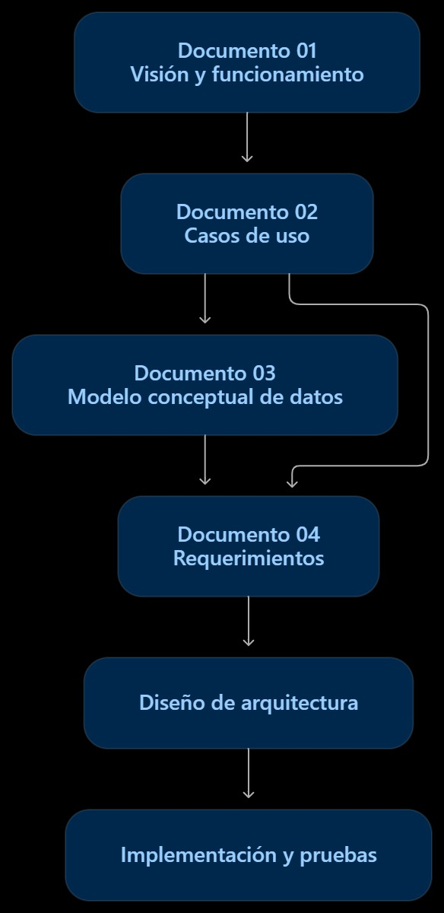
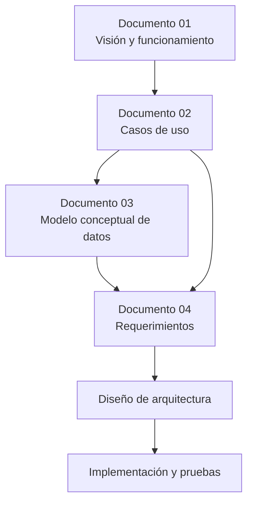

# Documentación de EarthScope AI

> ¿Primera vez? Empieza por la **[Guía para el equipo](GUIA_PARA_EL_EQUIPO.md)**.

## Mapa de documentos

| # | Documento | Estado | Lo siguiente |
|---|---|---|---|
| 01 | [Visión y funcionamiento](01_VISION_Y_FUNCIONAMIENTO.md) | v1.2 ✅ | Mantener al día |
| 02 | [Casos de uso](02_CASOS_DE_USO.md) | v0.3 · 12/15 criterios ✅ | Cerrar CU-10 (recorte) y CU-11 (valor por celda) |
| 03 | [Modelo conceptual de datos](03_MODELO_CONCEPTUAL.md) | v0.1 | Aprobar los ajustes propuestos al diagrama (§4.1) |
| 04 | [Requerimientos](04_REQUERIMIENTOS.md) | v0.1 borrador | **Completar los criterios marcados con ❓** |
| — | [Diseño de arquitectura](05_ARQUITECTURA.md) | v1.0 | Completar el despliegue |
| — | [Implementación y pruebas](06_IMPLEMENTACION_Y_PRUEBAS.md) | En curso | Agregar las pruebas pendientes (§4) |

## Referencia

| Documento | Para qué |
|---|---|
| [referencia/DOCUMENTACION_TECNICA.md](referencia/DOCUMENTACION_TECNICA.md) | Documento técnico principal: reto, reglas del evento, métodos, resultados, decisiones D1–D12, declaración de IA |
| [referencia/DATOS_GLOBALES.md](referencia/DATOS_GLOBALES.md) | Datos de todo el planeta (0,5°), MERRA-2, mapas de tendencia y API de análisis de áreas |
| [referencia/BLUEPRINT_PRODUCTO_FINAL.md](referencia/BLUEPRINT_PRODUCTO_FINAL.md) | Visión completa del producto (incluye lo que todavía no se construyó) |

## Gestión del trabajo

| Documento | Para qué |
|---|---|
| [gestion/RUBRICA_HISTORIAS_DE_USUARIO.md](gestion/RUBRICA_HISTORIAS_DE_USUARIO.md) | Formato de las HU, rúbrica de calidad (≥ 13/16), Definición de Listo y de Hecho, flujo y convenciones para los 2 repos |
| [gestion/BACKLOG_HU.md](gestion/BACKLOG_HU.md) | Lista de HU con estado (numeración única Frontend + Backend) |
| [PLAN_DE_TRABAJO.md](PLAN_DE_TRABAJO.md) | Tareas hasta la entrega |

## Diagramas
Los originales están en [`diagramas/`](diagramas/). Las versiones editables están en Mermaid dentro de cada documento; GitHub las dibuja solas.
