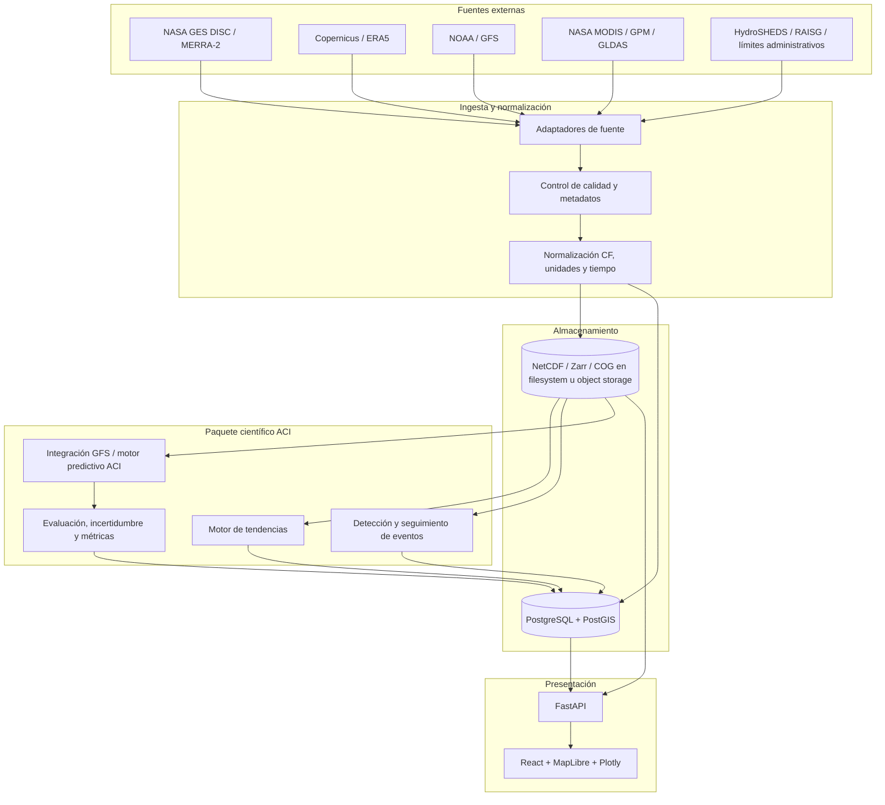

# Arquitectura técnica

## 1. Estilo arquitectónico

ACI será inicialmente un **monorepo modular** con una aplicación web, una API y un paquete científico compartido. No será una colección de microservicios independientes en la primera fase.

Los componentes se separan por responsabilidad, pero pueden ejecutarse en contenedores del mismo proyecto. Esto reduce complejidad, facilita tests y permite a Codex trabajar módulo por módulo.

## 2. Diagrama lógico



## 3. Módulos

### 3.1 Ingesta (`packages/aci_core/ingestion`)
Responsable de descubrir, descargar, verificar y registrar datasets. Un adaptador por fuente/producto. Debe ser idempotente y reanudable: ejecutar dos veces el mismo job no debe duplicar datos.

### 3.2 Normalización (`packages/aci_core/normalization`)
- Estandarizar nombres de variables sin perder nombre original.
- Convertir unidades explícitamente.
- Normalizar calendario y coordenadas.
- Conservar resolución y CRS originales.
- Escribir datos científicos a Zarr/NetCDF y tablas auxiliares a Parquet.

### 3.3 Geografía (`packages/aci_core/geography`)
Carga y valida cuenca, bioma, países y sectores. Debe manejar geometrías inválidas, reproyección y antimeridiano si aplica. Mantener identificadores persistentes de regiones.

### 3.4 Tendencias (`packages/aci_core/trends`)
Cálculo de climatologías, anomalías, tendencias, significancia estadística y corrección por pruebas múltiples. Separado del código de API.

### 3.5 Eventos (`packages/aci_core/events`)
Detecta episodios mediante umbrales documentados, agrupa celdas conectadas, genera trayectoria y resumen por región. Cada evento conserva el algoritmo y parámetros utilizados.

### 3.6 Predicción (`packages/aci_core/forecasting`)
- Lee GFS como baseline externo.
- Guarda inicialización, tiempo válido, horizonte, ciclo, resolución, fuente y variables.
- Ejecuta modelos ACI únicamente si cuentan con artefactos, características, entrenamiento y evaluación registrados.
- Publica incertidumbre y skill scores.

### 3.7 API (`services/api`)
Expone contratos REST versionados. No ejecuta descargas masivas ni cálculos pesados dentro de una solicitud HTTP. Las operaciones costosas se ejecutan como jobs CLI/worker y la API consulta resultados persistidos.

### 3.8 Web (`apps/web`)
Interfaz React para mapa, series, tendencias, eventos y pronósticos. Todas las capas muestran fuente, unidad, fecha y naturaleza del dato (reanálisis, observación o forecast).

## 4. Almacenamiento

| Tipo de información | Almacenamiento |
|---|---|
| Archivos originales de fuente | `data/raw/` local u object storage |
| Cubos multidimensionales procesados | Zarr v3 |
| Intercambio y archivos científicos | NetCDF |
| Resultados raster publicados | COG/GeoTIFF |
| Tablas intermedias | Parquet |
| Geometrías, catálogos y metadatos | PostgreSQL/PostGIS |
| Tendencias, eventos y predicciones resumidas | PostgreSQL/PostGIS |
| Logs de ejecución | salida estructurada + tabla de jobs |

PostgreSQL no debe almacenar cada píxel de cada hora como una fila relacional. Los cubos gridded se almacenan como Zarr/NetCDF; la base relacional guarda referencias, metadatos, geometrías, resúmenes e índices.

## 5. Flujo de datos

1. Un job solicita fuente, producto, periodo y región.
2. El adaptador descubre archivos disponibles.
3. Descarga a una zona raw temporal y verifica tamaño/checksum cuando exista.
4. Lee metadatos y valida dimensiones, unidades, calendario y coordenadas.
5. Normaliza a nombres CF acordados sin eliminar los metadatos de origen.
6. Procesa en bloques con Xarray/Dask.
7. Escribe el resultado versionado en Zarr/NetCDF.
8. Registra procedencia y cobertura en PostgreSQL.
9. Los motores científicos consumen datos normalizados.
10. La API consulta resultados y la web los muestra.

## 6. Interfaz de mapas

MapLibre GL JS será el motor de mapa. Las geometrías pequeñas se servirán como GeoJSON. Las grillas científicas grandes no se enviarán como miles de features GeoJSON.

Para el MVP:
- polígonos de cuenca y bioma como GeoJSON;
- capas de datos como raster tiles desde COG o imágenes pre-renderizadas;
- metadatos de capa disponibles desde API;
- cache de mapas derivados por variable/fecha/fuente.

No implementar un servicio de tiles complejo hasta disponer de un producto COG de prueba y una medición de rendimiento.

## 7. Entorno de desarrollo

Docker Compose levanta DB, API y web. Los procesos de descarga y ciencia se ejecutan con el mismo paquete Python dentro del contenedor worker o mediante comandos locales de `uv`.

Los datos voluminosos se montan en `./data` y se excluyen de Git. MinIO es opcional y solo se activa con un profile de Compose.

## 8. Estructura objetivo

No mover el código existente automáticamente. La estructura deseada a alcanzar de forma incremental es:

```text
.
├── AGENTS.md
├── README.md
├── pyproject.toml
├── uv.lock
├── package.json                 # opcional: scripts de monorepo
├── apps/
│   └── web/
├── services/
│   └── api/
├── packages/
│   └── aci_core/
│       ├── ingestion/
│       ├── normalization/
│       ├── geography/
│       ├── trends/
│       ├── events/
│       ├── forecasting/
│       └── evaluation/
├── pipelines/
│   ├── ingest/
│   └── jobs/
├── infra/
│   └── docker/
├── migrations/
├── data/
│   ├── raw/
│   ├── interim/
│   ├── processed/
│   └── boundaries/
├── notebooks/
├── tests/
├── docs/
│   └── aci/
└── legacy/
    └── streamlit/               # solo tras migración probada
```

La primera fase no necesita realizar esta reorganización completa. Codex debe inspeccionar el repositorio y proponer un plan de migración que respete los módulos existentes.
