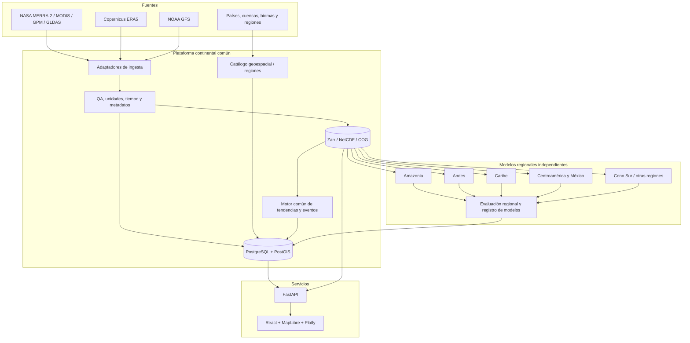

# Arquitectura técnica — LACI

## 1. Decisiones de diseño
LACI será un monorepo modular, continental en sus contratos y catálogo, con procesamiento y validación progresivos por región. Se adopta **arquitectura de modelos regionales especializados**. No se construirá un único modelo global como supuesto por defecto. Se comparte infraestructura, normalización, métodos y observabilidad; cada modelo regional mantiene dominio, datos, entrenamiento, evaluación y artefactos propios.

## 2. Diagrama lógico


## 3. Capas
### 3.1 Fuentes y adaptadores
NASA MERRA-2 y ERA5 para reconstrucción histórica; GFS como pronóstico numérico; productos satelitales para variables específicas. Un adaptador por fuente/producto, idempotente, reanudable y con registro de procedencia.

### 3.2 Data Core común
Normaliza nombres CF, unidades, calendario, coordenadas y metadatos sin perder los campos originales. Conserva resolución nativa y quality flags. Xarray/Dask para procesamiento por bloques; Zarr/NetCDF para cubos; Parquet para tablas intermedias.

### 3.3 Catálogo geoespacial
PostGIS guarda geometrías, jerarquías, identificadores estables y relaciones entre países, territorios, regiones analíticas, cuencas y biomas. Las regiones analíticas pueden solaparse. Cada geometría registra fuente, versión, licencia, CRS, escala y fecha. No usar bounding boxes como máscaras científicas.

### 3.4 Motor científico común
Climatologías, anomalías, tendencias, detección de calor y patrones de presión. Los métodos y tests son compartidos; los parámetros climatológicos y umbrales se calculan/validan para cada dominio regional.

### 3.5 Motor de modelos regionales
Cada región/modelo es una unidad versionada con:
- `region_id`, geometría/dominio y versión de máscara;
- variables de entrada y target;
- fuentes y periodos de entrenamiento;
- lead times/horizontes soportados;
- particiones temporales y espaciales;
- baseline y métricas por variable/horizonte;
- incertidumbre, artefacto, hash y versión de código;
- estado: experimental, validado, degradado o retirado.

Compartir librerías y pipelines no implica compartir pesos ni asumir transferencia entre regiones. Un modelo entrenado para Amazonia no se aplica a Andes o Caribe sin evaluación y autorización explícita. Si los datos de una región son insuficientes, el sistema debe mostrar GFS/baseline o “sin modelo LACI validado”.

### 3.6 API y web
FastAPI sirve catálogos, series, tendencias, eventos, disponibilidad y forecasts. Trabajos pesados se ejecutan como jobs/worker. React/MapLibre presenta mapas y Plotly series. Todas las vistas informan fuente, naturaleza del dato, unidades, resolución y validez.

## 4. Almacenamiento
- Raw: archivos originales en filesystem/object storage fuera de Git.
- Zarr/NetCDF: cubos científicos.
- COG/GeoTIFF: rasters publicados.
- Parquet: tablas intermedias.
- PostgreSQL/PostGIS: catálogo, regiones, geometrías, jobs, metadatos, resúmenes y registro de modelos.
No almacenar cada píxel horario como fila SQL.

## 5. Flujo de datos
1. Solicitar ingesta por fuente, producto, periodo y regiones.
2. Descubrir y descargar archivos; verificar checksums.
3. Leer dimensiones, unidades, calendario, variables y calidad.
4. Normalizar manteniendo variable original y resolución nativa.
5. Recortar por geometrías exactas y escribir Zarr/NetCDF.
6. Registrar procedencia y disponibilidad por región/variable/periodo.
7. Ejecutar métodos comunes de ciencia.
8. Entrenar/evaluar modelos regionales solo cuando existan datos apropiados.
9. Publicar resultados y métricas mediante API.
10. Mostrar explícitamente regiones sin cobertura suficiente.

## 6. Escalabilidad continental
- Diseñar ingestión por región/periodo/variable para permitir reanudación y cómputo parcial.
- Usar Dask/Xarray por chunks espaciales/temporales, medir tamaños antes de escalar.
- No descargar todo el continente ni todo el histórico en el primer sprint.
- Separar catálogo de disponibilidad de datos realmente procesados.
- Usar caché/COG/tiles bajo demanda; no enviar grillas densas como GeoJSON.
- Medir almacenamiento, transferencia, CPU y memoria por región.
- Mantener una política de retención y versionado de datos/modelos.

## 7. Estructura objetivo
```text
apps/web/
services/api/
packages/laci_core/
  ingestion/ normalization/ geography/
  climatology/ trends/ events/ forecasting/
  regional_models/ evaluation/ registry/
pipelines/ infra/ migrations/ data/ notebooks/ tests/ docs/aci/
```
No reorganizar el repositorio en bloque. Mantener módulos existentes hasta auditar y migrar con PRs pequeños.
