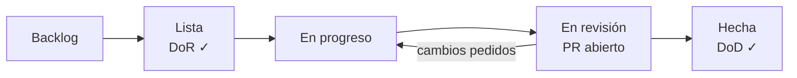

# Rúbrica para el manejo de Historias de Usuario (HU)

**Aplica a:** repositorio Frontend ([RK_Vanguard_EarthScopeAI](https://github.com/junher30/RK_Vanguard_EarthScopeAI)) y Backend ([RK_Vanguard_EarthScopeAI-BACK](https://github.com/jose6668/RK_Vanguard_EarthScopeAI-BACK))
**Fecha:** 14 de noviembre de 2026

Las HU traducen los casos de uso ([Documento 02](../02_CASOS_DE_USO.md)) y los requerimientos ([Documento 04](../04_REQUERIMIENTOS.md)) en trabajo concreto que una persona puede terminar en un PR.

---

## 1. Formato de una HU

Cada HU es un **Issue de GitHub** creado con la plantilla **"Historia de usuario"**.

```
HU-<número> · <título corto en infinitivo>

Como <rol>, quiero <acción>, para <beneficio>.

Criterios de aceptación (Dado / Cuando / Entonces)
  CA-1  Dado …, cuando …, entonces …
  CA-2  …

Trazabilidad: CU-xx · RF-xx · tarea del plan (si aplica)
Repositorio: Frontend | Backend | Ambos
Prioridad: Must | Should | Could
Estimación: 1 · 2 · 3 · 5 · 8 puntos
Dependencias: HU-yy
```

**Roles válidos:** visitante · estudiante · docente · investigador en formación · juez de Space Apps · equipo (para HU técnicas).

## 2. Rúbrica de calidad (antes de empezar una HU)

Cada criterio vale **0, 1 o 2** puntos. Una HU entra a desarrollo con **≥ 13 / 16** y **ningún criterio en 0**.

| # | Criterio | 2 · Excelente | 1 · Aceptable | 0 · Insuficiente |
|---|---|---|---|---|
| 1 | **Valor** | Dice qué gana el usuario (el "para…") | El beneficio es implícito | Solo describe una tarea técnica sin beneficio |
| 2 | **Independiente** | Se puede hacer y desplegar sola | Depende de una HU ya terminada | Bloqueada por HU sin empezar |
| 3 | **Pequeña** | ≤ 5 puntos, cabe en un PR | 8 puntos | > 8: hay que dividirla |
| 4 | **Criterios de aceptación** | ≥ 2 en formato Dado/Cuando/Entonces, medibles | Hay criterios, pero alguno es vago | No hay criterios |
| 5 | **Verificable** | Dice cómo se prueba (test, navegador, curl) | Se puede probar, pero no lo dice | No se puede comprobar |
| 6 | **Trazable** | Enlaza CU, RF o tarea del plan | Menciona el documento sin el número | Sin enlace |
| 7 | **Repositorio claro** | Indica Frontend, Backend o Ambos; si es Ambos, lista las 2 partes | Indica el repo, pero no las partes | No lo indica |
| 8 | **Integridad científica** | Si muestra datos: fuente, DOI, unidades y advertencias; si calcula: el cálculo va en `science/` | Menciona la fuente, pero no las advertencias | Calcula ciencia en el frontend o muestra datos sin fuente |

## 3. Definición de Listo (DoR) — para mover a "Lista"
- [ ] Puntaje ≥ 13/16 en la rúbrica y ningún 0.
- [ ] Tiene responsable y estimación.
- [ ] Si toca la API: está acordado el cambio en el formato de respuesta (los dos repos).
- [ ] Las dependencias están terminadas o no bloquean.

## 4. Definición de Hecho (DoD) — para cerrar
- [ ] Se cumplen todos los criterios de aceptación.
- [ ] PR revisado por otra persona y con la CI en verde.
- [ ] Pruebas nuevas o actualizadas: Backend `tests/`; Frontend tipos, lint y build.
- [ ] Textos visibles en **inglés**; fuente y DOI visibles si hay datos.
- [ ] Documentos actualizados (estado ✅ en CU, RF y plan).
- [ ] Si es "Ambos": los dos PR están unidos y se probaron juntos.

## 5. Flujo de estados (GitHub Projects o etiquetas)



| Etiqueta | Uso |
|---|---|
| `HU` | Toda historia de usuario |
| `frontend` / `backend` / `ambos` | Repositorio |
| `must` / `should` / `could` | Prioridad |
| `bloqueada` | Espera otra HU o una decisión |

## 6. Convenciones

| Qué | Formato | Ejemplo |
|---|---|---|
| Rama | `<tipo>/HU-<n>-<descripcion>` | `feat/HU-07-valor-por-celda` |
| Commit | `<tipo>(<área>): <mensaje> (HU-<n>)` | `feat(web): show cell value on click (HU-07)` |
| PR | Título con `HU-<n>`; en el cuerpo `Closes #<issue>` | `HU-07 · Cell value on click` |
| HU en ambos repos | Un issue en cada repo, enlazados entre sí | Backend `#12` ↔ Frontend `#31` |

**Numeración:** HU-01 … en orden de creación, única para los dos repos. Antes de crear una, revisen el último número en [BACKLOG_HU.md](BACKLOG_HU.md).

## 7. Rúbrica del manejo del backlog (para revisar el proceso del equipo)

| Aspecto | Bien (2) | Regular (1) | Mal (0) |
|---|---|---|---|
| Backlog ordenado | Must arriba; cada HU tiene prioridad | Hay prioridades, pero desordenadas | Sin prioridades |
| Trabajo en curso | ≤ 1 HU en progreso por persona | 2 por persona | 3 o más, o HU "olvidadas" |
| Revisión | Todo PR revisado en < 2 h durante el hackathon | Revisado, pero tarde | PR unidos sin revisión |
| Coordinación de repos | Las HU "Ambos" tienen sus 2 issues enlazados y se unen juntas | Enlazadas, pero unidas en distinto momento | Una parte rompe a la otra |
| Cierre | Cada HU cerrada cumple la DoD | Falta algún punto de la DoD | HU cerradas sin cumplir criterios |

## 8. Ejemplos (tomados del plan de trabajo)

**HU-07 · Ver el valor de una celda** — Frontend + Backend · Should · 5 pts · CU-11, RF-14, plan B1 + C3
> Como **estudiante**, quiero **hacer clic en el mapa y ver el valor exacto de ese lugar**, para **leer el dato sin adivinarlo por el color**.
- CA-1: Dado que hay una capa visible, cuando hago clic dentro de ella, entonces veo el valor, la unidad, el año y la fuente.
- CA-2: Dado que hago clic en una celda sin dato, entonces veo "No valid data for this cell and year".
- CA-3 (Backend): `GET /api/v1/cell?var&lat&lng&year` responde en < 500 ms con el valor del dataset.
- Prueba: `tests/test_api.py` amplía el contrato; prueba en el navegador.

**HU-08 · Recortar la capa al área dibujada** — Frontend · Should · 3 pts · CU-10, RF-13, plan B2
> Como **investigador en formación**, quiero **ver la capa solo dentro de mi polígono**, para **concentrarme en mi área de estudio**.
- CA-1: Dado un área confirmada y una capa activa, cuando activo "Clip to my area", entonces fuera del polígono no se dibuja la capa.
- CA-2: Dado que desactivo el recorte, entonces la capa vuelve a verse completa.

**HU-09 · Publicar la API** — Backend · Must · 5 pts · RNF-01, plan A2
> Como **juez de Space Apps**, quiero **que el análisis de áreas funcione desde el enlace público**, para **evaluar el producto sin instalar nada**.
- CA-1: Dado el enlace público de la API, cuando llamo `GET /api/v1/health`, entonces responde `"source": "full"` para las 5 variables.
- CA-2: Dado el sitio web publicado, cuando confirmo un punto, entonces el panel "Your point" muestra su tendencia en < 3 s.

**HU-10 · Simular escenarios en cualquier área** — Backend + Frontend · Could · 8 pts · plan C4 + B5
> Como **docente**, quiero **mover un deslizador de lluvia y ver cuánto cambiaría la temperatura en mi área**, para **explicar la relación entre clima y vegetación con datos reales**.
- CA-1: Solo se ofrece la simulación si el modelo supera la validación fuera de muestra (R² ≥ 0,3); si no, se muestra "no predictive skill".
- CA-2: El resultado muestra el intervalo de predicción del 95 % y avisa cuando hay extrapolación.
